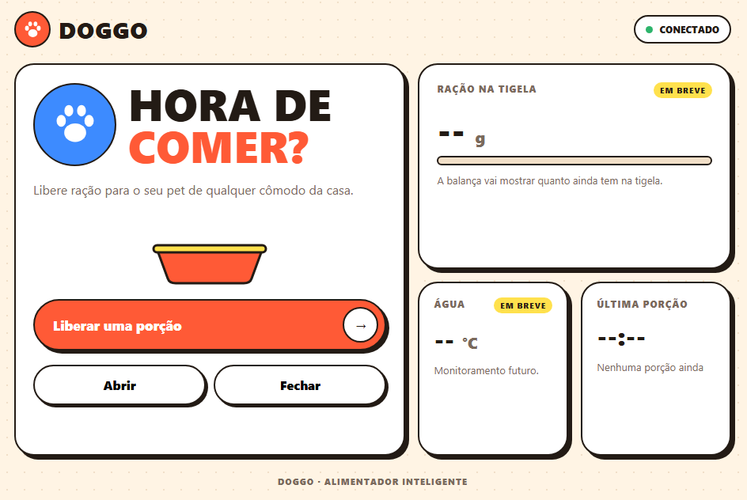

# Doggo

Sistema IoT embarcado em **ESP32** para alimentação e monitoramento da água de pets. O ESP32 funciona como servidor HTTP na rede local: por uma página web, o tutor libera ração e acompanha o peso da ração na tigela e a temperatura da água. Um bot do **Telegram** permite liberar ração à distância, consultar o estado do Doggo e receber avisos.

> **Estado do projeto:** o firmware integra o servo, a balança (HX711), o sensor de temperatura (DS18B20), a página web e o bot do Telegram. A liberação de ração é **temporizada**: o servo fica aberto por 400 ms. O acionamento de bomba, fonte ou relé está **fora do escopo**.



## Sumário

1. [Funcionalidades e progresso](#funcionalidades-e-progresso)
2. [Hardware e ligações](#hardware-e-ligações)
3. [Interface web](#interface-web)
4. [Bot do Telegram](#bot-do-telegram)
5. [Rede Wi-Fi e credenciais](#rede-wi-fi-e-credenciais)
6. [Protocolos e API](#protocolos-e-api)
7. [Registros de eventos](#registros-de-eventos)
8. [Estrutura do repositório](#estrutura-do-repositório)
9. [Como executar](#como-executar)

## Funcionalidades e progresso

| Recurso | Situação |
| :--- | :--- |
| Página de controle servida pelo ESP32 | Concluído |
| Abrir, fechar e liberar uma porção pelo servomotor | Concluído; porção **temporizada** (400 ms) |
| Leitura do peso da tigela (HX711) | Concluído; tara automática ao ligar, fator de calibração fixo |
| Leitura da temperatura da água (DS18B20) | Concluído |
| Peso, temperatura e última porção na página web | Concluído (atualiza a cada 2 s) |
| Bot do Telegram: liberar ração e consultar peso, temperatura e última porção | Concluído (somente no modo cliente Wi-Fi) |
| Aviso no Telegram a cada porção liberada, com data e hora | Concluído |
| Alerta no Telegram quando a água passa de 25 °C | Concluído |
| Data e hora por NTP | Concluído (usada no Telegram e na última porção) |
| Wi-Fi cliente e modo ponto de acesso (AP) | Concluído; escolhido em `USAR_AP` |
| Acionamento de bomba, fonte ou relé | **Fora do escopo** |

O texto "cerca de 25 g" nas mensagens do Telegram é uma estimativa (`PORCAO_G`), e **não** uma medição do que caiu no pote.

## Hardware e ligações

| Componente | Função | Pinos do ESP32 |
| :--- | :--- | :--- |
| ESP32 | Controlador, servidor web, Wi-Fi e bot do Telegram | — |
| Servomotor SG90 (9 g) | Abre e fecha o dispenser de ração | Sinal GPIO 19, alimentação 5V |
| Célula de carga de 1 kg + HX711 | Mede a ração na tigela | DT GPIO 16, SCK GPIO 17, alimentação 3V3 |
| DS18B20 à prova d'água | Mede a temperatura da água | DATA GPIO 25, alimentação 3V3, resistor de 4,7 kΩ entre DATA e 3V3 |

O passo a passo das ligações, com as cores dos fios, está no [guia de conexões](docs/guia-de-conexoes.md). Use uma alimentação adequada para o servomotor e mantenha o GND comum.

O Doggo **monitora** a temperatura da água, mas não liga nem desliga bomba ou fonte.

## Interface web

A página servida em `/` tem:

- botão **Liberar uma porção** (rota `/dose`) e botões **Abrir** e **Fechar** a comporta;
- peso da ração na tigela, com uma barra de nível (500 g = tigela cheia);
- temperatura da água (`--` quando não há leitura);
- horário da última porção e por onde ela foi liberada (site ou Telegram);
- indicador de conexão com o ESP32.

Os dados vêm da rota `/dados`, consultada a cada 2 segundos.

## Bot do Telegram

O bot só funciona no **modo cliente Wi-Fi** (`USAR_AP = false`), porque precisa de internet. No modo AP ele fica desativado.

| Comando | O que faz |
| :--- | :--- |
| `/start` ou `/menu` | Mostra o menu com os botões |
| `/liberar` ou `/racao` | Libera uma porção (temporizada) e envia a confirmação com data e hora |
| `/status` | Peso na tigela, temperatura da água, última porção e hora atual |
| `/peso` | Peso da ração na tigela |
| `/temperatura` | Temperatura da água |
| `/ultima` | Data, hora e origem da última porção |
| `/dieta` (ou `/porte`, `/racaoindicada`) | Tabela de quantidade de ração por porte do cachorro |
| `/id` | Responde com o chat ID de quem enviou (usado para configurar o `CHAT_ID`) |

- **Acesso:** só o chat configurado em `CHAT_ID` pode usar os comandos; os outros recebem "Acesso negado". O `/id` responde a qualquer um.
- **Aviso de porção:** toda porção liberada, pelo site ou pelo Telegram, gera uma mensagem com data, hora e origem.
- **Alerta de temperatura:** quando a leitura válida passa de **25 °C** (`TEMP_LIMITE`), o bot envia um alerta e repete no máximo a cada 30 minutos enquanto a água continuar quente. Quando a temperatura volta para 24,5 °C ou menos, ele avisa que voltou ao normal. Sem leitura do sensor, nenhum alerta é enviado.

## Rede Wi-Fi e credenciais

As configurações ficam no início de `firmware/doggo/doggo.ino`:

| Constante | Uso |
| :--- | :--- |
| `USAR_AP` | `false`: conecta à rede Wi-Fi de casa. `true`: o ESP32 cria a própria rede |
| `WIFI_SSID`, `WIFI_SENHA` | Rede Wi-Fi de casa (modo cliente) |
| `AP_SSID`, `AP_SENHA` | Rede criada pelo ESP32 no modo AP: **`Doggo`**, senha **`doggo123`** |
| `BOT_TOKEN`, `CHAT_ID` | Token do bot (fornecido pelo @BotFather) e chat autorizado |

**Segurança:** o repositório é público. Preencha `WIFI_SENHA`, `BOT_TOKEN` e `CHAT_ID` **só na sua cópia local** e não faça commit com esses valores. Quem tiver o token controla o bot. A senha do AP (`doggo123`) é pública: não a reutilize em outras redes ou serviços. Credenciais que já foram publicadas no histórico do repositório devem ser trocadas.

## Protocolos e API

| Camada | Tecnologia | Situação |
| :--- | :--- | :--- |
| Aplicação | HTTP (interface web e rotas) | Concluído |
| Aplicação | HTTPS com a API do Telegram | Concluído |
| Aplicação | NTP (`pool.ntp.org`, fuso UTC-3) | Concluído |
| Transporte | TCP, porta 80 | Concluído |
| Rede / enlace | IPv4, Wi-Fi IEEE 802.11 b/g/n | Concluído |

### Rotas

| Método | Rota | Comportamento |
| :--- | :--- | :--- |
| `GET` | `/` | Página HTML de controle |
| `GET` | `/abrir` | Abre a comporta (servo em 90°); responde `Aberto` |
| `GET` | `/fechar` | Fecha a comporta (servo em 0°); responde `Fechado` |
| `GET` | `/dose` | Abre por 400 ms e fecha, registra a porção e avisa no Telegram; responde `Porção liberada!` |
| `GET` | `/dados` | JSON com `peso` (g), `temp` (°C ou `null`), `ultima` (hora) e `nota` (data e origem) |

As rotas não exigem login: qualquer dispositivo na mesma rede consegue acionar o servo.

## Registros de eventos

O firmware escreve as mensagens no Monitor Serial (115200 baud) e guarda na memória a última porção (data, hora e origem), mostrada na página e no Telegram. Essa informação se perde ao reiniciar o ESP32.

As decisões da equipe estão em [decisões da equipe](docs/decisoes.md).

## Estrutura do repositório

```text
Doggo/
├── README.md
├── docs/
│   ├── guia-de-conexoes.md      Ligações do hardware
│   ├── interface-web.png        Captura da interface web
│   └── decisoes.md              Decisões e escopo da equipe
└── firmware/
    └── doggo/
        └── doggo.ino            Firmware completo (página web, sensores e Telegram)
```

## Como executar

1. Instale a [Arduino IDE](https://www.arduino.cc/en/software) e o pacote de placas **esp32** da Espressif.
2. Pelo Gerenciador de Bibliotecas, instale:
   - **ESP32Servo**;
   - **HX711 Arduino Library** (Bogdan Necula);
   - **OneWire** e **DallasTemperature**;
   - **UniversalTelegramBot** (Brian Lough) e **ArduinoJson**, que ele usa.
3. Abra `firmware/doggo/doggo.ino` e preencha, na sua cópia local:
   - `USAR_AP` (`false` para a rede de casa e o Telegram; `true` para a rede própria `Doggo`);
   - `WIFI_SSID` e `WIFI_SENHA`;
   - `BOT_TOKEN` e `CHAT_ID` (para descobrir o `CHAT_ID`, grave o firmware, mande `/id` para o bot e copie o número).
4. Faça as ligações seguindo o [guia de conexões](docs/guia-de-conexoes.md), selecione a placa e a porta e envie o firmware.
5. Ligue o Doggo **com a tigela vazia na balança**: a tara é feita automaticamente ao ligar.
6. Abra o Monitor Serial a **115200 baud** e veja o endereço na linha `Acesse: http://...`.
7. Abra esse endereço num navegador conectado à mesma rede. No modo cliente, o bot também envia o menu no Telegram ao iniciar.
